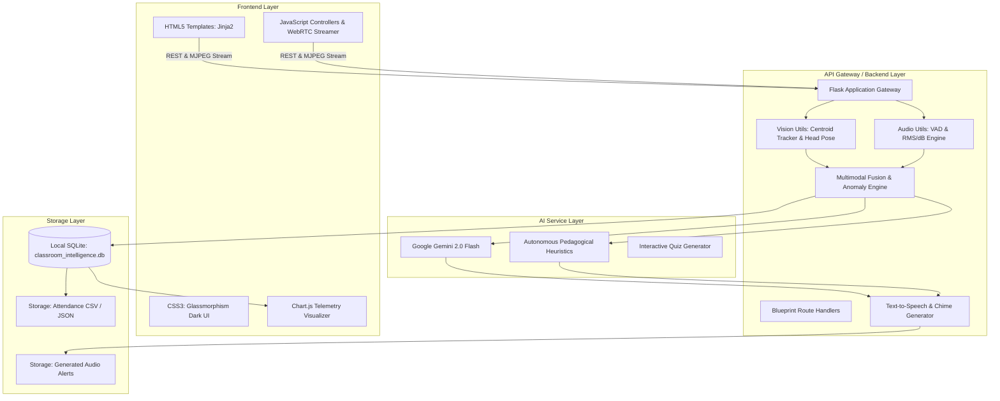

# 🎓 Multimodal Attendance & Engagement Agent

[](https://www.python.org/)
[](https://flask.palletsprojects.com/)
[](https://opencv.org/)
[](https://ai.google.dev/)
[](LICENSE)

An intelligent, privacy-preserving classroom intelligence platform developed for **SkillWallet | Generative AI with Google Cloud**.

The system fuses **computer vision** (face detection, centroid tracking, sustained presence verification, head pose estimation, inactivity alerts), **audio signal processing** (energy RMS/dB, voice activity detection, classroom interaction mode classification), and **agentic reasoning** (Google Gemini 2.0 Flash with autonomous offline heuristic fallback) to automatically mark accurate attendance, monitor classroom engagement dynamics, and provide real-time AI-driven teaching suggestions.

---

## 📑 Table of Contents
1. [Key Capabilities & Scenarios](#-key-capabilities--scenarios)
2. [Technical Architecture](#-technical-architecture)
3. [Multimodal Fusion Formulation](#-multimodal-fusion-formulation)
4. [Sustained Presence Logic](#-sustained-presence-logic)
5. [Directory Structure](#-directory-structure)
6. [Installation & Setup](#-installation--setup)
7. [Running the Application](#-running-the-application)
8. [Comprehensive Testing](#-comprehensive-testing)
9. [REST API Documentation](#-rest-api-documentation)
10. [SkillWallet Mentor Evaluation Guide](#-skillwallet-mentor-evaluation-guide)

---

## 🚀 Key Capabilities & Scenarios

### Scenario 1: Automated Attendance Tracking
* **Sustained Presence Filtering**: Eliminates false positives caused by single-frame or transient doorway appearances. A student must remain visible for $\ge 15\text{ seconds}$ (configurable) and $\ge 40\%$ of the active session to receive full attendance.
* **Timestamped Attendance Logs**: Automatically records exact `First Seen`, `Last Seen`, and accumulated duration timestamps.
* **Status Classification**: Automatically categorizes students into `Present`, `Tardy` (arrived late into session), `Left Early` (absent during latter half), or `Absent`.
* **Exporting**: One-click downloadable CSV and JSON attendance logs.

### Scenario 2: Engagement and Session Dynamics Analysis
* **Head Pose & Attention Angle**: Classifies visual orientation into `Attentive (Front Focus)`, `Note-Taking / Screen Focus` (head tilted downwards), and `Distracted` (looking sideways away from instruction).
* **Movement Dynamics & Inactivity Detection**: Analyzes frame-to-frame pixel variations around student bounding boxes to detect prolonged inactivity ($>30\text{ seconds}$) or active interaction.
* **Acoustic Interaction Classification**: Analyzes microphone audio streams using RMS energy and Zero-Crossing Rates to distinguish between:
  * `Independent Study / Silence`
  * `Teacher Monologue`
  * `Active Discussion / Student Q&A`
  * `Guided Instruction`

### Scenario 3: AI-Driven Teaching Suggestions
* **Google Gemini 2.0 Flash Integration**: Consumes live session telemetry (engagement drops, sustained monologue, low movement) to deliver actionable 1–2 sentence pedagogical interventions in real-time.
* **Autonomous Offline Heuristic Engine**: When no internet connection or API key is present, the agent transitions seamlessly to an offline pedagogical rules engine calibrated to active learning principles (Think-Pair-Share, 60-second pulse polls, pacing recalibration).
* **Text-to-Speech (TTS) Alerts**: Native speech synthesis via browser Web Speech API and stored chime audio alerts.
* **Instant Pulse Quiz Generator**: Generates 3-question concept check quizzes on demand to re-energize the room.

---

## 🏛 Technical Architecture

The architecture mirrors the system blueprint:



---

## 📐 Multimodal Fusion Formulation

Classroom engagement is computed continuously across time $t$ by normalizing and weighting visual attention, body movement, and acoustic interaction:

$$E_{\text{composite}}(t) = \frac{w_{\text{pose}} \cdot S_{\text{pose}}(t) + w_{\text{move}} \cdot S_{\text{move}}(t) + w_{\text{audio}} \cdot S_{\text{audio}}(t)}{w_{\text{pose}} + w_{\text{move}} + w_{\text{audio}}}$$

* **Default Weighting**:
  * $w_{\text{pose}} = 0.40$ (Head pose attention alignment)
  * $w_{\text{move}} = 0.35$ (Physical motion vs inactivity)
  * $w_{\text{audio}} = 0.25$ (Acoustic classroom interaction level)
* **Attention Drop Trigger**: Flagged whenever $E_{\text{composite}}(t) < 40.0\%$ or drops $>25\%$ from the moving average.
* **Monologue Fatigue Trigger**: Flagged when continuous single-speaker speech is detected with student movement $< 45\%$.

---

## ⏱ Sustained Presence Logic

Traditional systems mark attendance based on momentary appearance in a single frame. In real classrooms, this leads to false positives from janitors, visitors, or students briefly glancing through the doorway.

The **StudentPresenceTracker** resolves this by computing:

$$R_{\text{presence}} = \frac{T_{\text{visible}}}{\max(T_{\text{session}}, 1)}$$

1. **Transient Filter**: If $T_{\text{visible}} < T_{\text{min\_sustained}}$ ($15\text{s}$ default), status remains `Pending (Transient)` and is excluded from roll call.
2. **Present**: If $T_{\text{visible}} \ge T_{\text{min\_sustained}}$ and $R_{\text{presence}} \ge 0.40$.
3. **Tardy**: If first detected after $25\%$ of elapsed session time has transpired.
4. **Left Early**: If last seen timestamp precedes the active session end by more than the absence grace period ($25\text{s}$).

---

## 📂 Directory Structure

```text
Skill Wallet Project/
│
├── app.py                     # Main Flask Application Entry Point
├── config.py                  # Global Configuration & Environment Settings
├── requirements.txt           # Python Package Dependencies
├── run.bat                    # Windows 1-Click Launch Script
├── run.ps1                    # PowerShell Launch Script
├── test_suite.py              # Automated Unit Test Suite (6/6 passing)
├── README.md                  # Comprehensive Documentation
│
├── utils/                     # Core Intelligence & Processing Modules
│   ├── __init__.py
│   ├── vision_utils.py        # Face Detection, Tracking & Head Pose
│   ├── audio_utils.py         # Acoustic RMS, dB, Speech & VAD Engine
│   ├── fusion_utils.py        # Multimodal Fusion & Anomaly Detection
│   ├── genai_utils.py         # Gemini 2.0 Flash & Heuristic Teaching Agent
│   ├── storage_utils.py       # SQLite Persistence, Roster & CSV Export
│   ├── simulation_utils.py    # Synthetic Multi-Student Classroom Generator
│   └── tts_utils.py           # Audio Chime & Speech Synthesis Engine
│
├── routes/                    # Flask Blueprints
│   ├── __init__.py
│   ├── view_routes.py         # HTML UI Page Route Handlers
│   └── api_routes.py          # RESTful Endpoints & MJPEG Stream
│
├── templates/                 # Jinja2 HTML5 Dashboard Templates
│   ├── base.html              # Layout, Responsive Navbar & Live Clock
│   ├── index.html             # Main Dashboard & Roster Overview
│   ├── live_monitor.html      # Live Video Feed, Gauges & AI HUD
│   ├── attendance.html        # Roll Call Table, Search & CSV Export
│   ├── analytics.html         # Chart.js Dynamics & Interaction Breakdown
│   ├── suggestions.html       # Gemini Chat & Quick Quiz Generator
│   └── settings.html          # Thresholds, Weights & API Key Configuration
│
├── static/                    # Frontend Styling & JavaScript
│   ├── css/
│   │   └── style.css          # Modern Dark Glassmorphism UI
│   └── js/
│       ├── main.js            # Shared Navbar Utilities & Clocks
│       ├── live_monitor.js    # Telemetry Polling & Web Speech Synthesis
│       └── charts.js          # Chart.js Time-Series Configuration
│
└── storage/                   # Local Storage (Privacy-Preserving)
    ├── classroom_intelligence.db # SQLite Database
    ├── audio/                 # Generated Audio Alerts
    ├── reports/               # Downloadable Session Reports
    └── uploads/               # Pre-recorded Video Tracks
```

---

## ⚙️ Installation & Setup

### Prerequisites
* Windows, macOS, or Linux
* Python 3.9, 3.10, 3.11, 3.12, 3.13, or 3.14

### 1. Clone or Open Project
```powershell
cd "c:\Users\DELL\OneDrive\Documents\Skill Wallet Project"
```

### 2. Install Dependencies
```powershell
py -m pip install -r requirements.txt
```

*(Or `python -m pip install -r requirements.txt`)*

---

## 🏃 Running the Application

### Option 1: 1-Click Windows Batch Runner
Double-click `run.bat` or run:
```cmd
run.bat
```

### Option 2: PowerShell
```powershell
.\run.ps1
```

### Option 3: Direct Python
```powershell
py app.py
```

Open your browser and navigate to:
👉 **`http://localhost:5000`**

---

## 🧪 Comprehensive Testing

To verify the system end-to-end, run the automated test suite:

```powershell
py test_suite.py
```

**Test Coverage Highlights:**
* ✅ Database initialization and 8-student default roster verification.
* ✅ Sustained presence threshold test (distinguishes transient vs full attendance).
* ✅ Audio RMS energy and interaction mode acoustic classification.
* ✅ Multimodal mathematical fusion calibration ($E = 0.40 \cdot S_{pose} + 0.35 \cdot S_{move} + 0.25 \cdot S_{audio}$).
* ✅ Gemini GenAI offline fallback resilience.
* ✅ Flask HTTP status codes for live video, telemetry, and CSV export.

---

## 📡 REST API Documentation

| Method | Endpoint | Description |
|---|---|---|
| `GET` | `/` | Main Dashboard UI with KPI cards and student roster |
| `GET` | `/monitor` | Live classroom feed with telemetry gauges |
| `GET` | `/attendance` | Full attendance records and roll call management |
| `GET` | `/analytics` | Session engagement dynamics and time-series charts |
| `GET` | `/suggestions` | AI Teaching Assistant hub and Gemini consultation |
| `GET` | `/api/video_feed` | Real-time MJPEG live stream with HUD tracking |
| `GET` | `/api/telemetry/live` | Combined multimodal telemetry and active alerts |
| `POST` | `/api/suggestions/generate_manual` | Request on-demand AI pedagogical intervention |
| `POST` | `/api/ai/ask` | Consult Gemini 2.0 Flash on classroom pacing |
| `POST` | `/api/ai/quiz` | Generate 3-question active learning quiz |
| `GET` | `/api/attendance/export` | Download timestamped attendance logs (CSV) |
| `POST` | `/api/settings/update` | Update thresholds, weights, and Gemini API key |

---

## 🎓 SkillWallet Mentor Evaluation Guide

When presenting this project to your mentor on **SkillWallet.ai**:

1. **Demonstrate Automated Attendance (Scenario 1)**:
   * Open `http://localhost:5000/monitor`.
   * Observe student faces dynamically tracked with bounding boxes and sustained presence timers.
   * Navigate to the **Attendance** tab (`/attendance`) to show the automatically generated roll call table with exact `First Seen`, `Last Seen`, and `Status` badges (`Present`, `Tardy`, `Absent`).
   * Click **Export Attendance CSV** to demonstrate downloadable reporting.

2. **Demonstrate Engagement Dynamics & Multimodal Fusion (Scenario 2)**:
   * On `/monitor`, observe the live **Classroom Engagement Index** gauge, head pose classification (Attentive / Note-Taking / Distracted), and acoustic interaction levels.
   * Navigate to the **Session Analytics** tab (`/analytics`) to display the interactive Chart.js timeline showing attention dips and recovery windows.

3. **Demonstrate AI Teaching Suggestions (Scenario 3)**:
   * Click **Request AI Teaching Tip** or observe automated triggers when engagement dips.
   * Enable **Audio Alerts** to demonstrate native Text-to-Speech synthesis.
   * Open the **AI Teaching Assistant** tab (`/suggestions`) to show interactive questions answered by Gemini 2.0 Flash (or the offline pedagogical expert system) and generate a 3-question pulse quiz.

4. **Highlight Privacy & Edge Architecture**:
   * Emphasize that the system can run 100% offline with zero outbound network calls, preserving student privacy and complying with institutional ethical requirements.
